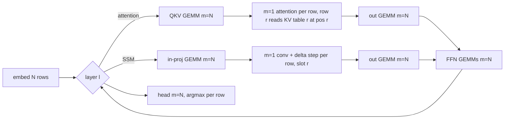

# Batched experiment harness (plan 13 step 49): one forward for N items needs a window.mojo change

No entry point in the engine puts two independent sequences through one forward. A3B pair mode
looks like it does and does not: it steps slot A, synchronizes, then steps slot B, each a full m = 1
forward. A harness built on it would pass the ids gate trivially and save no GPU time. The step
therefore needs an engine change, which the research lane's brief forbids ("write it up and stop").
Status 2026-09-24: **design only, nothing built, nothing run.** Read from `lane-research` at `d08b53d`.

## Every existing batch path is one sequence or one forward per sequence

| path | what it batches | one forward for N items? |
|---|---|---|
| A3B, `run_a3b_pair` (`serve/engine.mojo`) | two requests in two `SEQ_CAP` slots (`sequence_bufs` views of conv, SSM, KV, token buffers) | no: `step_window` on view A, sync, then view B; weights read twice |
| prompt replay / prefill rows (`replay_m`, `MROWS`) | up to `MROWS` consecutive positions of one sequence | no: one KV table, one recurrent state |
| spec verify rows (`kernels/test_moe_rows.mojo`, `test_ssm_rows.mojo`) | draft rows of one sequence, byte-equal to the m = 1 dot helpers | no, same reason |

Interleaving items A3B-style still has a use (host syncs amortised, one resident engine), but it
leaves the cost at one m = 1 forward per item, and the cost is the point: E11b dev paid 0.38 s per
graft run.

## The design: row-batched GEMMs, per-row recurrence

A decode step over N sequences, row r = sequence r at its own position:

- GEMMs at m = N reuse the replay row kernels, which call the m = 1 dot helpers in the same
  per-element order (P3 stage B: m = 4 replay bit-exact). Weights are read once for N rows; that
  is the whole gain.
- Attention and the SSM step stay the m = 1 kernels, launched per row against that row's slot (or
  one launch with a sequence grid dimension running the same per-row code). No sum is reordered,
  so byte equality with N single forwards holds by construction, and is tested anyway.
- Never the dense chunk kernels (`amar_attn_prefill_wmma`, `amar_ssm_delta_chunk_w`): they
  reorder sums, and replay identity is the gate.
- Each item prefills alone as today, joins the batch at its first generated token, and leaves it at
  its stop id. Graft arms stay single-sequence (one m = 1 graft step per item).

Size: engine L (window step over N views, row-batched head, per-row stop). Kernel-adjacent, so per
repo policy it runs on fable, after the lane that owns `window.mojo` is free.

## The gate, frozen before any build

1. Byte test per touched kernel, `test_moe_rows` style: row-batched outputs at N = 2, 4, 8
   byte-equal to N m = 1 outputs, dense q4 shapes.
2. Ids: the 100 E11b countries dev B prompts (arm 0, 64 tokens, stop-aware) at N = 4 and N = 8
   give ids byte-equal to the same build's single-sequence run, 100 of 100. Pack sha
   `715d4c34...`. The single-sequence arm is re-run on the candidate build, never read from
   another commit's cache.
3. Speed (reported, not gated): seconds per item at N = 1, 4, 8 on those prompts.

Prediction: about 2x per item at N = 4, less at N = 8 (plan 13 step 5 has the m = 4 GEMM at 1.73
m = 1 steps; the SSM per-row floor note puts the batching ceiling near 2.3x at m = 4 and 1.46x at
m = 8). GPU for 2 and 3: about 3 minutes once built.

What this does not settle: whether the per-row attention and SSM launches eat the GEMM saving at
N = 8. The speed row at N = 8 is the falsifier; if it is under 1.3x, cap N at 4.
